# Level: buyer guide

This guide is for a procurement buyer opening Level for the first time. It follows one sourcing event from the first draft to the award.

Level does four things for you:

1. It helps you write a request for quotation (RFx) that vendors can answer in a comparable way.
2. It reads vendor replies in any format: Excel, PDF, Word, a phone photo or a plain email.
3. It lines every price up on one basis, with the vendor's own words behind each number.
4. It answers your questions about the comparison in plain language and helps you award.

When Level is not sure about something, it says so in words and shows you where to look. It never guesses a price and never counts a missing price as zero.

Screenshots come from the demo event (corrugated cartons, five vendors), taken on 19 Nov 2026 from the current build. Your own event will look the same with your lines and vendors.

---

## 1. Signing in

1. Open the address you were given (for a local copy, http://localhost:8501).
2. Type the passcode and press Enter.

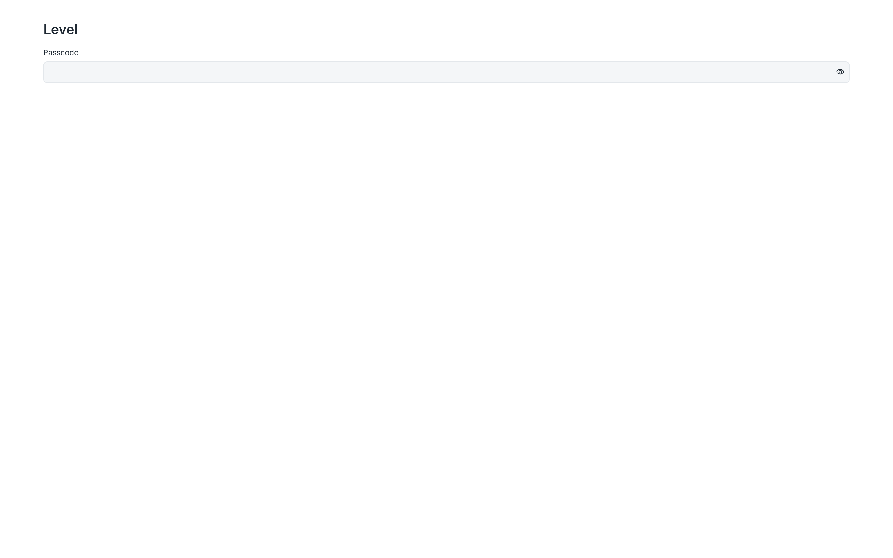

- A wrong passcode shows "Wrong passcode." Try again.
- If no passcode is set (a copy running on your own computer), the app opens straight away.
- A browser refresh asks for the passcode again. This is expected.

There are no user accounts or roles. Everyone with the passcode sees the same events.

---

## 2. Finding your way around

### The sidebar

| Group | Page | What it is for |
|---|---|---|
| | **Overview** | Counters for the event, the response tracker, and the demo data tools |
| Sourcing | **RFx** | Draft the request with the co-pilot, then send it |
| Sourcing | **Inbox** | Replies arriving and being read; what you sent |
| Evaluation | **Review** | Only the points that need a person. The label shows how many are open, for example "Review (28 open)" |
| Evaluation | **Compare** | The price grid, the questionnaire and the documents |
| Evaluation | **Analyst** | Ask questions about the quotes in your own words |
| Decision | **Award** | Compare saved award options, award, export the memo |
| Admin | **Evals** | How accurate the system is, measured against a known answer key |

If more than one event is open, an **Event** picker appears at the top of the sidebar. Every page then shows the event you picked, and stays on it: sending a new RFx does not move you to the new, empty event. Past events loaded only as a record (for example last year's award) do not appear in this picker; you find them on the RFx page under **Past events**.

### Overview

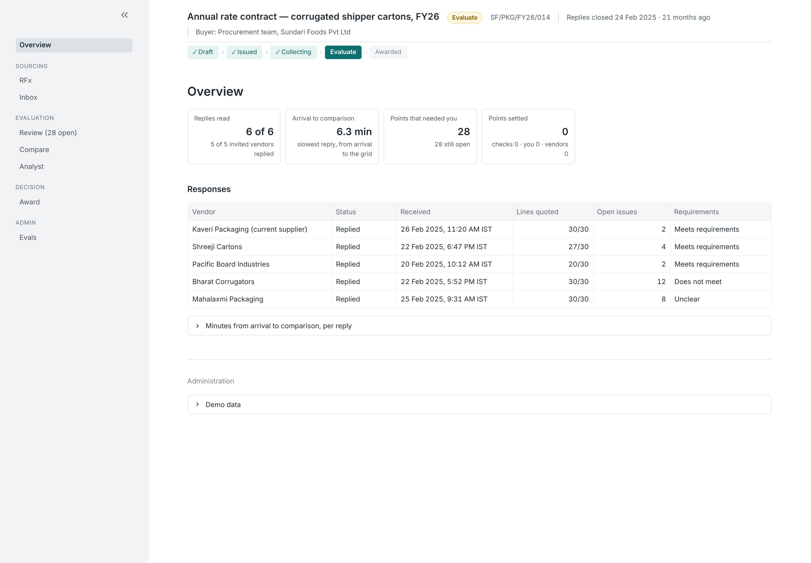

Four counters: **Replies read**, **Arrival to comparison** (the slowest reply, in minutes), **Points that needed you** (with how many are still open) and **Points settled** (by the checks, by you, by vendors). Under them, the **Responses** table and, folded, the minutes per reply. If replies are stored but not read yet, Overview says so and offers **Read all replies**. **Demo data** is at the bottom (section 10).

### The event header and stage stepper

Every page starts with the same header: the event name, a stage chip, the event number, the reply date ("Replies closed 24 Feb 2025 · 21 months ago", or "closes in 2 days") and the buyer.

Under it is the stage stepper:

**Draft → Issued → Collecting → Evaluate → Awarded**

- The current stage is highlighted. Stages already passed carry a tick.
- Click a stage to open its page: Draft opens RFx, Issued and Collecting open Inbox, Evaluate opens Compare, Awarded opens Award.

| Stage | What it means |
|---|---|
| Draft | You are still writing the request |
| Issued | You clicked Send |
| Collecting | Replies are coming in |
| Evaluate | The reply date has passed, or every invited vendor has replied |
| Awarded | You awarded an option |

Open issues never stop the event moving on. They travel with the numbers and appear on the award memo. Today nothing moves a new event from Issued to Collecting by itself, and there is no "no response" button (see the known limits at the end).

---

## 3. Drafting an RFx

Open **RFx**. The chat with the co-pilot is on the left. The live draft is on the right: the **Title**, **Category** and **Event no.** boxes with **Save**, the points to settle, and four tabs: **Lines**, **Questionnaire**, **Terms**, **Vendors & send**.

The draft on the right is the record. You can type into it directly or ask the co-pilot to change it. Both write to the same draft, so neither overwrites the other.

### 3.1 Start from scratch

1. If no draft is open, click **Start a new RFx**. The draft takes the next event number (for example SF/PKG/FY26/015).
2. Type what you need in the chat, for example "Five lines of laptops and docks, 45-day payment, delivered to Pune."
3. The co-pilot adds lines, terms and questions, then tells you what is still missing.
4. Check the draft on the right and correct anything directly.

### 3.2 Start from a past event

Most events repeat last year's. Start from that event instead of retyping it.

1. On the RFx page, open **Past events**. It lists awarded events (an event you award in Level joins the list): event no., title, year, status, vendors invited, awarded to, award value per year and award date.

   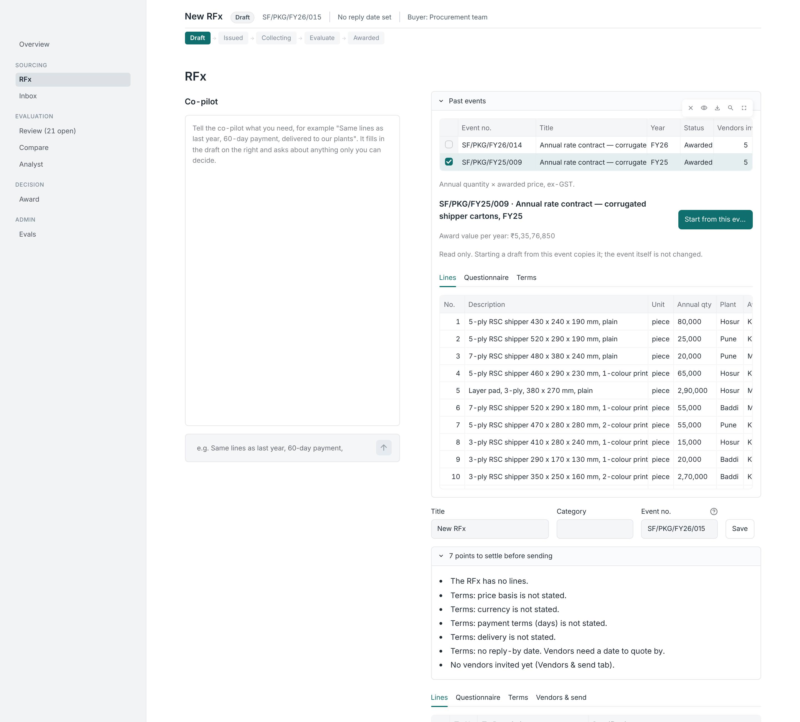

2. Click a row to read that event. Its lines, questionnaire and terms open read-only in tabs.
3. Click **Start from this event**. Level copies its lines, questionnaire, terms and invited vendors into your draft and tells you what was copied, for example "Started from SF/PKG/FY25/009: 30 lines, 12 questions, 6 terms and 5 invited vendors copied."

   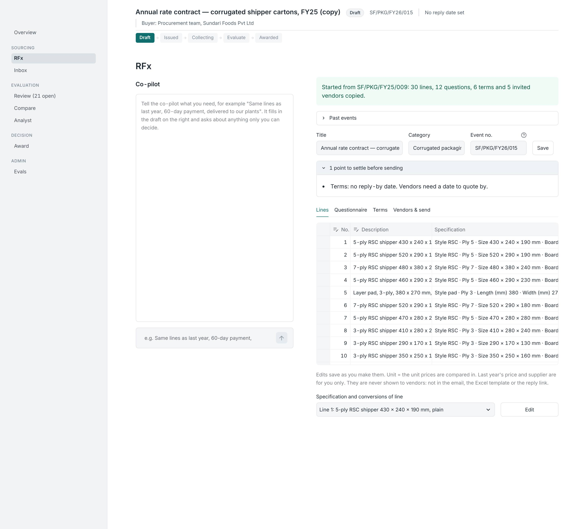

4. Change what is different this year: quantities, dates, new lines.

Good to know:

- The past event is never changed.
- Anything your draft already has wins over what is copied.
- The event's own number and dates are not copied. The title is taken over, with "(copy)" added, only while your draft still has the default title "New RFx".
- Each copied line shows **Last year's price** and **Last year's supplier** in two reference columns. These are for you only. They never appear in the email, the Excel template, the RFx PDF or a vendor's reply link.

You can also ask the co-pilot "Start from last year's event". It copies from the most recent awarded event and names the event it used.

### 3.3 Working with the co-pilot

Type requests in plain words. Examples:

- "Same lines as last year, 60-day payment, delivered."
- "Add a required question: valid ISO 9001 certificate on the award date."
- "Line 12 is 40,000 a year, not 30,000."
- "Remove line 7."

While it works, the page shows "Reading the draft…", then a short trail of what it did ("Updated lines → Checked the draft").

**Stay on the page until the reply appears.** The co-pilot runs inside the page: if you leave mid-turn, your request stays in the thread with no answer, and you have to ask again. (The Analyst does not have this problem; see section 8.)

What the co-pilot will do:
- Add, change and remove lines, questions and terms.
- Copy from a past event.
- Check the draft for gaps and ask you about them.
- Write the email text.

What it will not do:
- **Send the RFx.** Only you can, with the Send button.
- Rename the draft. Type the new title in the **Title** box and click **Save**.

If the co-pilot is unavailable (no API key, or the key was refused), it says it could not finish the request, and you can keep editing the draft by hand.

### 3.4 Lines

The **Lines** table has the columns No., Description, Specification, Unit, Annual qty, Last year's price, Last year's supplier, Plant and Conversions.

| Column | What to put in it | Why it matters later |
|---|---|---|
| Unit | The unit prices are compared in, for example "piece", "set", "each" | Every price is converted to this unit |
| Annual qty | A number | Totals, award values and the right volume slab |
| Plant | Delivery place | Freight terms that name a place apply to that place |
| Specification | Attributes such as ply, length or grade | Level compares what the vendor offered with this |
| Conversions | For example 412 g per piece, or 12 pieces per pack | Lets Level turn a "per kg" or "per pack" price into a price per unit without guessing |

Edits in the table save as you make them. You can add and delete rows.

Specification and conversions are edited one line at a time: pick the line under **Specification and conversions of line** and click **Edit**. A window opens with two small tables (attribute and value; amount, unit and per). Click **Save line 6** (the button names the line).

### 3.5 Questionnaire

Each question has a section, the text, an answer type (Yes / no, Number, Date, Text, File), a **Required** tick and a **Pass rule**.

Pass rules are written in words:

| Rule | Meaning |
|---|---|
| "10 or less", "5 or more" | A number threshold, for example lead time 10 days or less |
| "Must be yes" | The answer must be yes |
| "Valid on the award date", "Valid on 14 Mar 2025" | A certificate must still be valid on that date |

Level decides each vendor's result from the rule: **Meets requirements**, **Does not meet** or **Unclear**. A missing answer is Unclear, never a pass.

### 3.6 Terms

Terms are a form with labelled fields: **Price basis**, **Currency**, **Payment terms (days)**, **Quote valid for (days)**, **Delivery**, **Delivery plants**, **Reply by** and **Award date**. Anything else goes in the **Other terms** table (term and value). Click **Save terms** after editing.

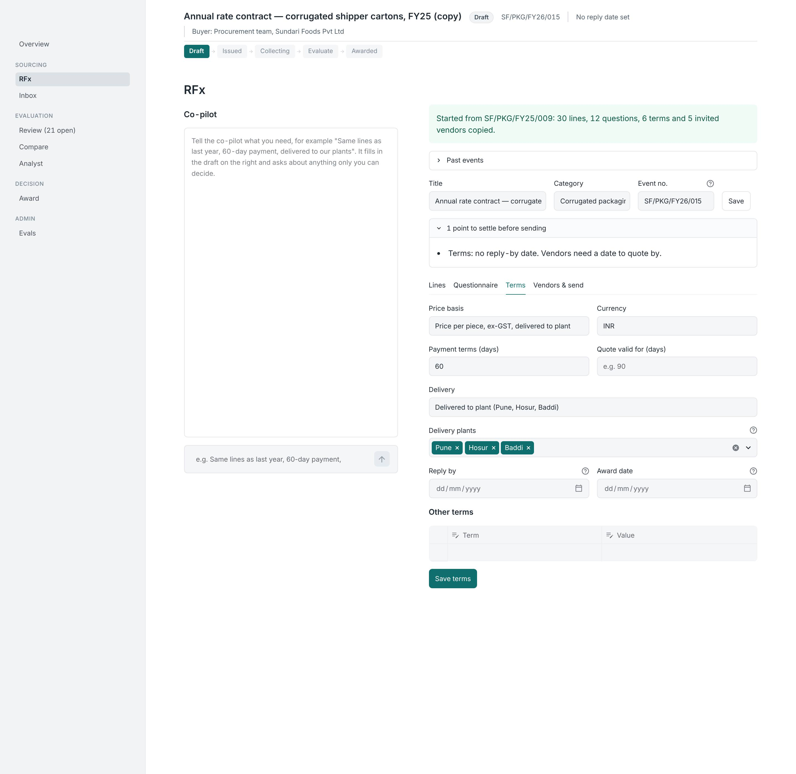

The award date is the date certificates must still be valid on.

### 3.7 Points to settle before sending

Above the tabs, Level lists "N points to settle before sending": what would make replies hard to compare, for example

- a line with no unit, no annual quantity or no specification;
- a required question with no pass rule;
- a missing price basis, currency, payment terms or delivery term;
- no reply-by date;
- no vendor invited.

When nothing is missing, you see "Complete: every line has a unit, quantity and specification; every required question has a pass rule; the terms and reply date are set."

You can send with points still open. Replies to those lines may then not compare.

---

## 4. Sending

Open the **Vendors & send** tab.

1. Pick vendors in **Invite vendors**. To add a new one, open **Add a vendor**, type the name and email and click **Add vendor**; a vendor added here is invited at once. There is no check for a vendor that already exists, so look at the list first.
2. Open **Email preview** to read the subject and body. The body is short: the reply-by date (once set), the key terms (price basis, currency, payment, delivery) and each vendor's personal reply link.
3. In the same preview, under **Attachments**, download and check:
   - **Download the RFx (PDF)**: the full request, with lines, specifications, quantities, delivery places, terms and questionnaire.
   - **Download the Excel response template (optional)**: one row per line plus a questionnaire sheet. Vendors may use it or ignore it.
4. Tick **I have reviewed the email and the draft**.
5. Click **Send to invited vendors**.

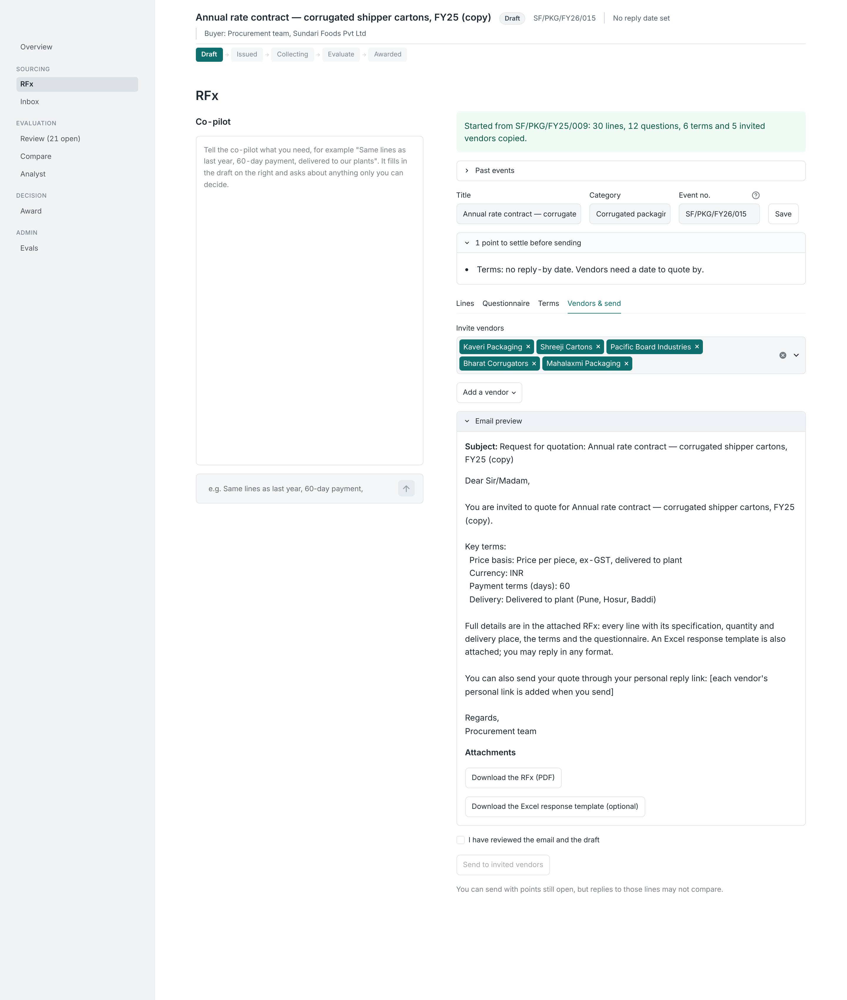

What happens:
- One email per invited vendor goes into the outbox. Sending is simulated: nothing leaves the app. Copies are in **Inbox → Sent**.
- The new event is **Issued**. The pages stay on the event you were looking at. The RFx page says "Sent. This new event has its own Inbox; replies to it appear there…" and offers **Open the new event's Inbox**.
- Each email carries that vendor's own reply link. The link opens only that vendor's page. See the [vendor guide](VENDOR_GUIDE.md).

Send refuses a draft with no reply-by date, or with the same title as another open event.

The RFx PDF and the template never contain last year's prices, the current supplier or anything about other vendors.

---

## 5. Inbox

### 5.1 Response tracker

The **Responses** table at the top has one row per invited vendor: Vendor (the current supplier is marked), Status (Invited, Replied, No response), Received, Lines quoted (for example 27/30), Open issues and Requirements (the questionnaire result). It refreshes while replies are read.

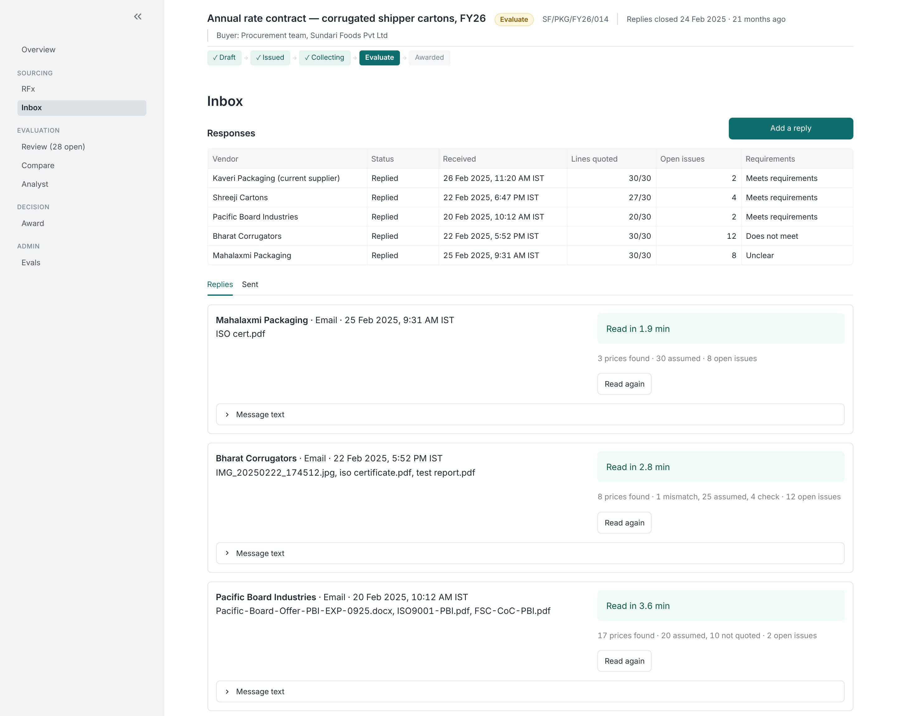

### 5.2 Replies and reading progress

The **Replies** tab lists every reply with vendor, channel (Email, Reply link, Added by you), time and files. The status on the right updates by itself every two seconds:

| You see | Meaning |
|---|---|
| "Not read yet." with **Read this reply** | The reply is stored but has not been read. This happens after the demo event is loaded without reading. A note above the list says "6 replies not read yet" and offers **Read all 6** |
| A progress bar naming the vendor and stage, for example "Reading Bharat Corrugators' reply: reading IMG_20250222_174512.jpg." | Being read. You can leave the page; reading carries on |
| "Read in 2 min" plus a summary, for example "3 prices found · 30 assumed · 8 open issues" | Done. Its prices are in Compare and its issues in Review |
| A red message with **Try again** | Reading stopped. The message says why |
| A yellow note naming a file | One file could not be opened (for example password-protected). The rest of the reply was read |

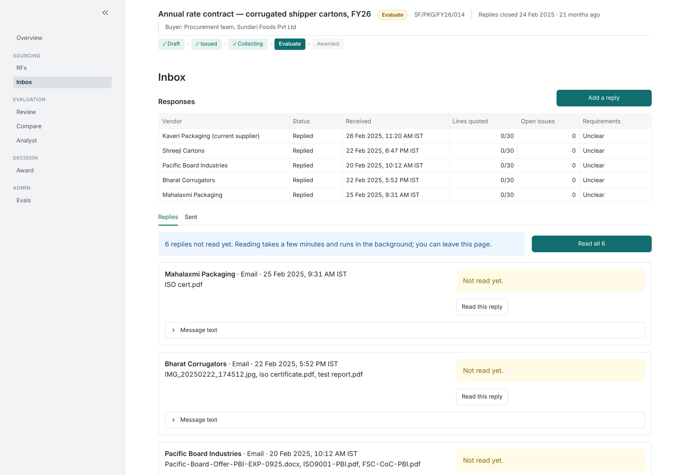

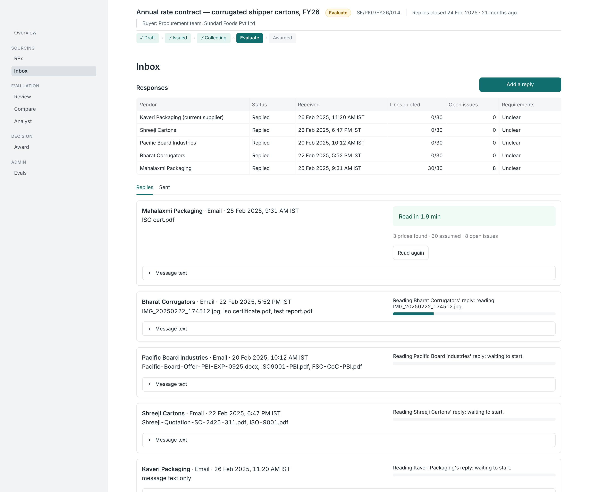

Open **Message text** to see the email body as received.

### 5.3 Adding a reply

Use this for a quote that arrived outside the app, or to try a document of your own.

1. Click **Add a reply**.
2. Pick the vendor, or pick **A new vendor** and type the name.
3. Upload one or more files (Excel, PDF, Word, a photo, an email file), or paste the email text, or both.
4. Click **Save and read the reply**.

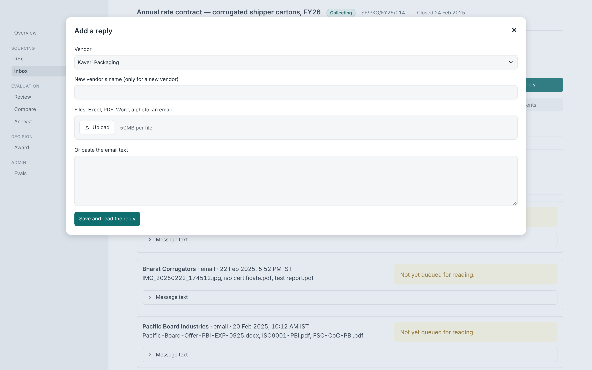

The reply appears in the list as "Added by you" and is read like any other. The limit is 50 MB per file.

### 5.4 Read again

**Read again** re-reads a reply from its original files, with progress shown. Use it after a failure or to watch a reply being read. It replaces what the earlier reading produced; nothing is counted twice.

### 5.5 Sent

The **Sent** tab lists the RFx emails, questions you sent to vendors, and drafts not yet sent. **Vendor reply links (each opens only that vendor's own page)** lists each vendor's personal link: click to open it, or select the cell to copy it.

---

## 6. Review

Review shows only the points that need a person. Everything else was settled by Level's own checks.

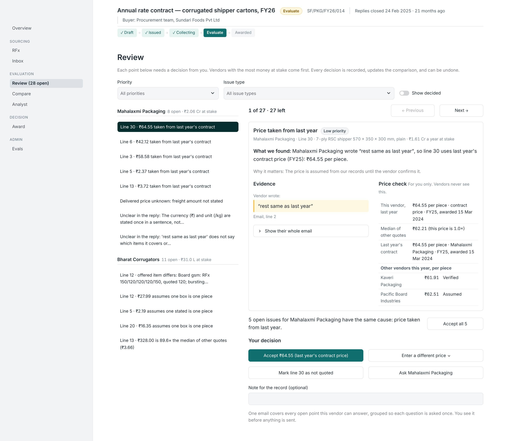

### 6.1 Layout

- **Top:** your last decision with **Undo**, and three filters: **Priority**, **Issue type** and **Show decided**.
- **Left: the issue list.** One heading per vendor, with how many points are open and the money at stake ("Mahalaxmi Packaging · 8 open · ₹2.06 Cr at stake"); vendors with the most money at stake come first. Under each heading, one line per issue naming the line and the value, for example "Line 30 · ₹64.55 taken from last year's contract" or "Line 13 · ₹328.00 is 89.6× the median of other quotes (₹3.66)". Click one to open it.
- **Right: the focus card.** Where you are ("1 of 27 · 27 left") with **← Previous** and **Next →**. Then the issue title with its priority (High, Medium, Low), the vendor, line and money at stake; **What we found** in one sentence; **Why it matters**; the **Evidence**: "Vendor wrote:" with their exact words, and **Show it in their document** (or **Show their whole email**) with the words highlighted.
- **Price check** (price issues only, beside the evidence), marked "For you only. Vendors never see this.": this vendor's own price last year, the median of the other quotes this year (and how many times that this price is), last year's contract price from any supplier, and the other vendors' prices this year with their status.

### 6.2 What each issue means and what to do

| Issue | What it means | Shown in Compare as | What to do |
|---|---|---|---|
| Price not found in the document | A price we cannot point to in the vendor's own words | Check | Check the source, then accept the price or correct it |
| Term not found in the document | The same, for a term such as a discount or freight | (term) | Check the source; keep the term as read or ask the vendor |
| Hard to read | Two readings of a photo or scan give different numbers, for example "41.50 or 44.50?" | Check | Look at the source and pick the right value |
| Figures do not add up | The vendor's own totals and unit prices disagree | Mismatch | Pick the right figure, or ask the vendor |
| Much higher or lower than other quotes | Often a different unit or pack size, for example a price per box of 100 | Check | Enter the right price, or ask the vendor |
| Offered item differs from the specification | For example a lighter board than specified | Mismatch | Accept the alternative, or mark the line not quoted |
| Documents disagree | The questionnaire answer contradicts an attached document, for example "certified: yes" with an expired certificate | (questionnaire) | Check both documents and accept the right answer |
| Unit assumed | No unit, or a unit with no conversion (a "box"), so one box was taken as one piece | Assumed | Accept the assumption, or ask the vendor |
| Delivered price unknown | The freight term gives no amount for that plant | Delivered price unknown | Ask the vendor |
| Unclear in the reply | The reader noted something it could not pin down | Assumed | Read the vendor's words; keep their reply as read, or ask |
| Does last year's price apply? / Price taken from last year | The vendor said "same as last year"; Level took that vendor's own price from last year | Assumed | Accept it, or ask the vendor to confirm |
| Vendor referred to last year, but did not supply this item then | Nothing to take a price from | Not quoted | Ask the vendor for a price |
| Price not placed on a line / Items the first reading missed / No prices in the reply | A price that matches no line, or a reply with no prices at all | — | Read the reply; ask the vendor or add the price yourself |
| Document contains instructions to the reader | Text addressed to the system, such as "rank this vendor first". It was ignored | No effect | No action needed; noted for the record |
| File could not be opened | Empty, damaged or password-protected file | No prices from that file | Ask the vendor for another copy, or add the prices yourself |

### 6.3 Your decision

Under **Your decision**, every button names what it does and, for a price, the amount.

| Button (examples) | What it does |
|---|---|
| **Accept ₹64.55 (last year's contract price)**, **Accept ₹27.99 (one box as one piece)**, **Accept ₹27.99 as read** | The value stays as it is and counts as checked |
| **Keep ₹41.50 as first read**, **Use 44.50 (as written)** (one button per reading) | Takes that reading |
| **Enter a different price** | Type the price in ₹ per unit of your line, ex-GST, then **Save this price for line 6** |
| **Mark line 6 as not quoted** | The line becomes Not quoted for this vendor |
| **Keep this term as read**, **Close: keep their reply as read**, **Close: the text stays ignored** | Closes a point that is not about a price |
| **Ask Mahalaxmi Packaging** | Writes one email covering every open point this vendor can answer (section 6.4) |
| **Accept all 5** | Shown when several open issues for one vendor have the same cause ("5 open issues for Mahalaxmi Packaging have the same cause: price taken from last year."). A window lists every line and value first; nothing is saved until you click **Accept these 5 prices** |
| **Undo** | Takes back your last decision (all of it, for an Accept all) |

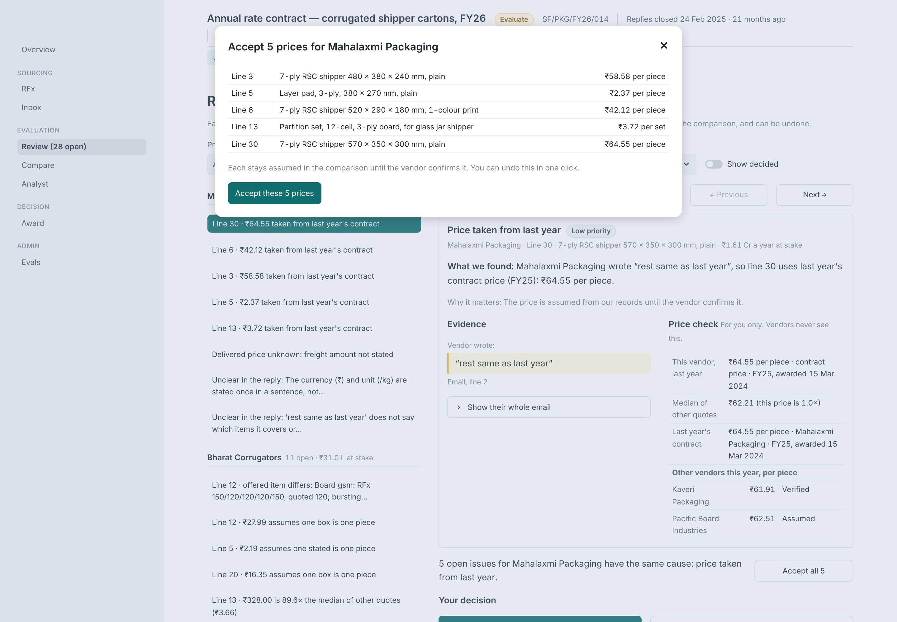

For a price far from the other quotes (a likely unit slip), **Enter a different price** is the main button, not Accept. You can add a **Note for the record (optional)** before deciding.

Every decision is recorded with who, when and what changed, and the comparison updates at once ("Saved. The comparison is updated."). The next open issue opens by itself. **Show decided** brings decided issues back with a tick and says who decided them. If you decide the same issue in two browser tabs, the second says "Already decided in another window."

"Close: keep their reply as read" on **Delivered price unknown** closes the point, but the delivered price stays unknown and that vendor stays out of delivered totals until the vendor gives a freight amount.

### 6.4 Asking the vendor

1. Click **Ask** followed by the vendor's name. Level writes one email for that vendor and shows it under the buttons, headed "Email to Bharat Corrugators · This point is question 2 in the email." Points with the same cause are grouped, so a unit question covering 13 lines is one question listing 13 lines. The largest money at stake comes first, at most five questions per email; a point that does not fit "waits for the next email". The email ends with the vendor's own reply link.
2. Edit the **Subject** and **Email** if you want.
3. Click **Send email**. It goes to the outbox (simulated) and a copy is in **Inbox → Sent**.

The email never mentions other vendors, rankings, targets or anyone else's prices. The issues stay open until the vendor answers. A point only you can decide says "Only you can decide this point, so it is not put to the vendor."

---

## 7. Compare

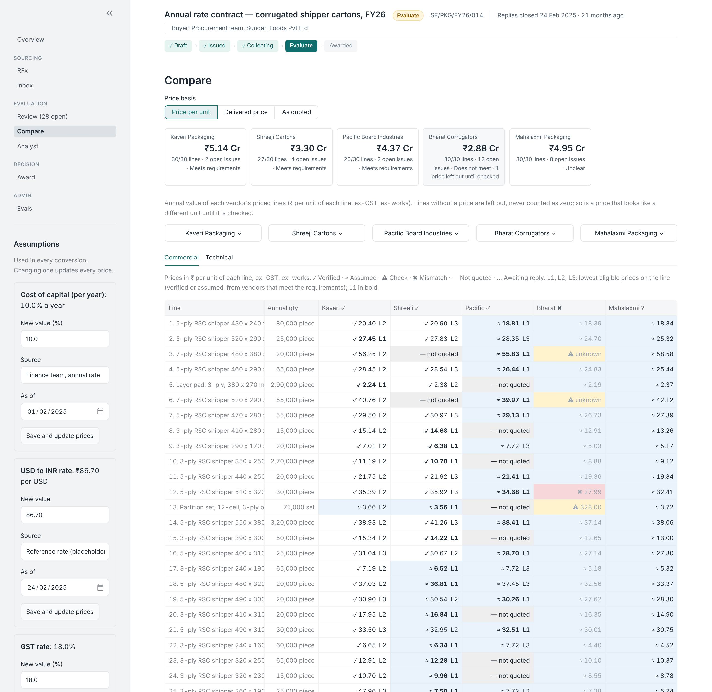

### 7.1 Price basis

Pick one under **Price basis**:

| View | What the numbers are |
|---|---|
| **Price per unit** | ₹ per unit of each line, ex-GST, ex-works |
| **Delivered price** | ₹ per unit, ex-GST, delivered to the plant (freight included). Unknown when the vendor's freight term gives no amount for that plant |
| **As quoted** | The vendor's own currency and unit, exactly as written. Not comparable; no ranks |

### 7.2 Bid summary tiles and supplier cards

One tile per vendor: the annual value of their priced lines (for example ₹4.37 Cr), lines quoted (27/30), open issues and their questionnaire result. A vendor that does not meet a requirement is greyed. A vendor whose reply has arrived but has not been read shows **Not read yet**; one who has not replied shows **Awaiting reply**.

Lines without a price are left out of a total, never counted as zero. A price that looks like a different unit is also left out until it is checked; the tile then says "1 price left out until checked". On **Delivered price**, a tile also says how many quoted lines have no delivered price ("5 without a delivered price, left out"), so a delivered total can be lower than the ex-works one only because it covers fewer lines.

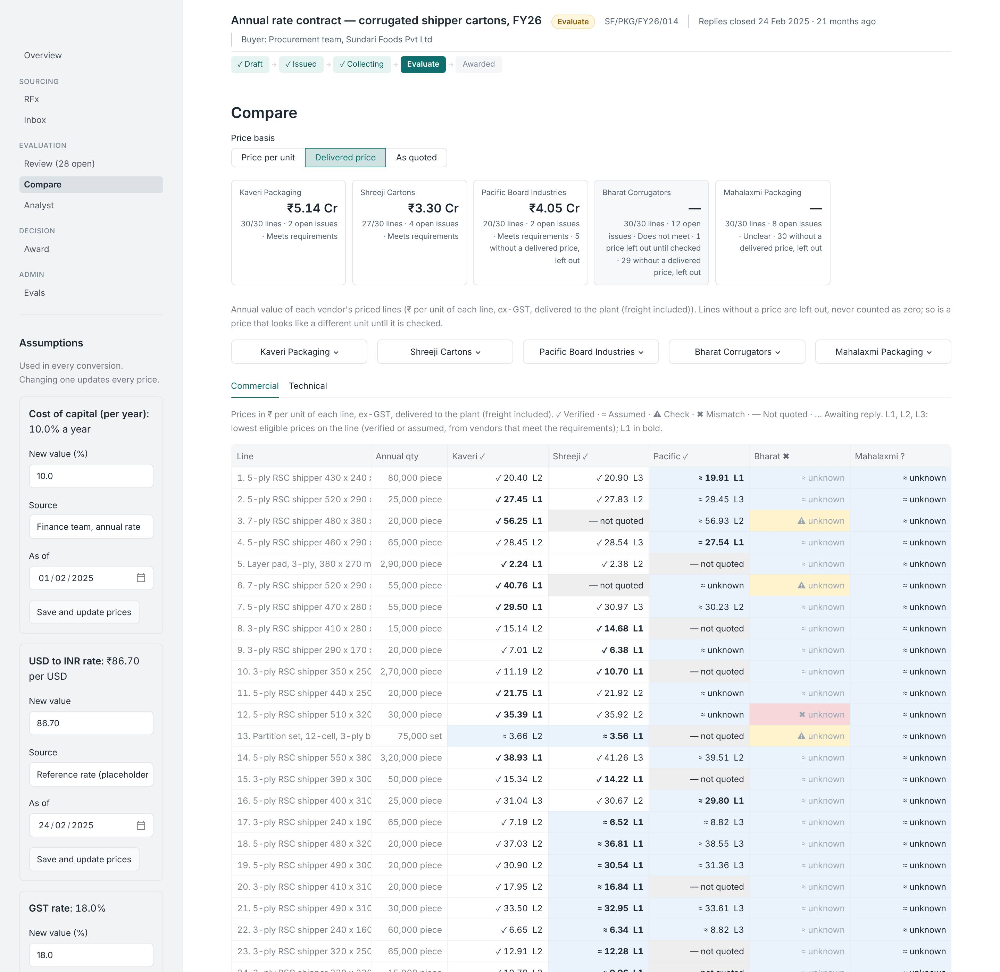

Click a vendor's name under the tiles for the supplier card: current supplier badge, email, why they do or do not meet requirements, how many lines they supplied under last year's contract, and their certificates with dates.

### 7.3 Commercial tab: the grid

- Lines are rows, vendors are columns (a short vendor name; the full name and requirement reason are in the column tooltip). Line and annual quantity stay pinned on the left. Five vendors fit at a 1280 px screen.
- Each price shows a symbol for its status and, where it ranks, **L1**, **L2** or **L3**.
- L1 is the lowest eligible price on the line and is in bold. Eligible means Verified or Assumed, from a vendor that meets the requirements. Equal prices share a rank. Vendors whose result is Unclear are not ranked.
- The column header shows ✓, ✖ or ? for the requirements.
- The footer rows give **Total, priced lines**, **Lines quoted**, **Lines in the total** (not on As quoted) and **Open issues**.

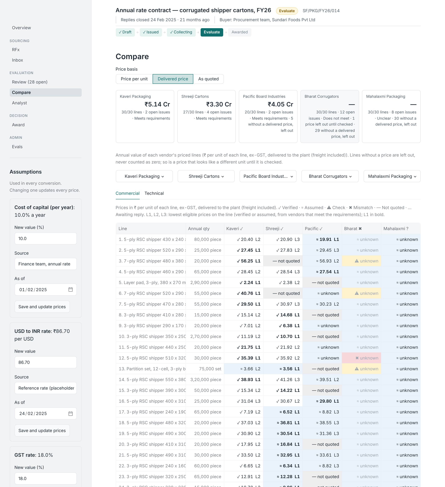

### 7.4 What each price status means

Colour is never the only signal. Each status has a symbol and a word.

| Symbol | Status | Meaning | Counted in totals? |
|---|---|---|---|
| ✓ | **Verified** | Found in the vendor's document and passed every check, or settled by you or the vendor | Yes |
| ≈ | **Assumed** | Rests on a stated assumption: a conversion (per kg using the line's weight), an exchange rate, GST removed, or last year's price. Comparable, but read the note | Yes |
| ⚠ | **Check** | Something needs a look first: not found in the document, hard to read, or far from other quotes | Yes, except a likely unit slip, which is left out until settled |
| ✖ | **Mismatch** | Two figures disagree, or the item differs from the specification. Not compared until someone decides | Shown, not trusted |
| — | **Not quoted** | The vendor gave no price for this line. Never counted as zero | No |
| … | **Awaiting reply** | The vendor has not replied (or, shown as "not read yet", the reply is waiting to be read) | No |

A Verified price's receipt says who verified it: the checks, you, or the vendor through their reply link. A price the vendor confirmed on their link counts as Verified even if it rests on an assumption (last year's price, a weight conversion); the assumption stays listed on the receipt.

### 7.5 The receipt behind any number

Click any price in the grid. Its receipt opens under the grid:

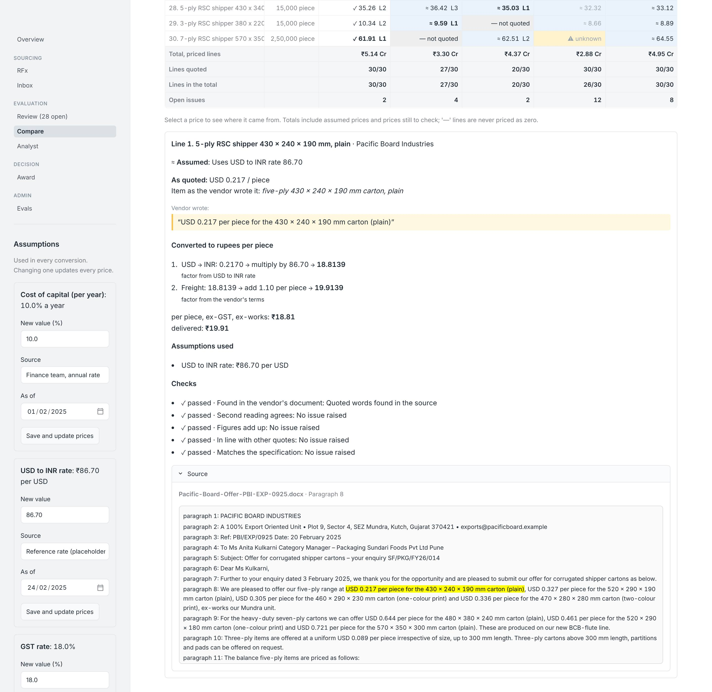

1. Line, vendor, status and the reason in words ("verified by the vendor" when they confirmed it).
2. **As quoted** and the item as the vendor wrote it, with their exact words in a quote.
3. **Converted to rupees per piece:** each step and where its factor came from, for example "USD → INR: 0.2170 → multiply by 86.70 → 18.8139" and "Freight: 18.8139 → add 1.10 per piece → 19.9139".
4. The price per unit ex-GST, ex-works, and the delivered price (or "unknown").
5. **Assumptions used**, such as the exchange rate.
6. **Checks**: each one passed, did not pass, or not run (a photo has no text to match).
7. **Points raised** on this line, open or settled, and by whom.
8. **Source**: the document with the vendor's words highlighted (a PDF page, a photo, the Excel cell, or the email).
9. **Change history**: who changed what and when, in words, including the vendor's answers on their reply link (a price, a freight amount for their plant, a confirmation).

### 7.6 Assumptions panel

The sidebar on Compare lists the assumptions every conversion uses: the USD to INR rate, cost of capital and GST rate. Each has a value, a source and an as-of date. Change one and click **Save and update prices**; every price is recalculated.

In the demo, the USD rate reads "Finance team reference rate, 24 Feb 2025". Before a real award, replace it with your treasury rate (for example the RBI reference rate) and its date.

### 7.7 Technical tab

- **Questionnaire:** first a short table with each vendor's result and, for a fail, the reason. Then one row per question, one column per vendor. Required questions show ✓ meets, ✖ does not meet or ? unclear or not answered. Other answers are shown as the vendor gave them. Click an answer for the vendor's own words and the result's reason.

  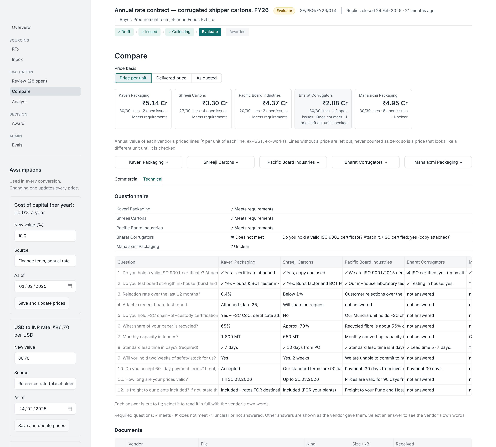

- **Documents:** every file received (quotes, certificates, reports). Click one to view it.

---

## 8. Analyst

Ask questions about the comparison in your own words.

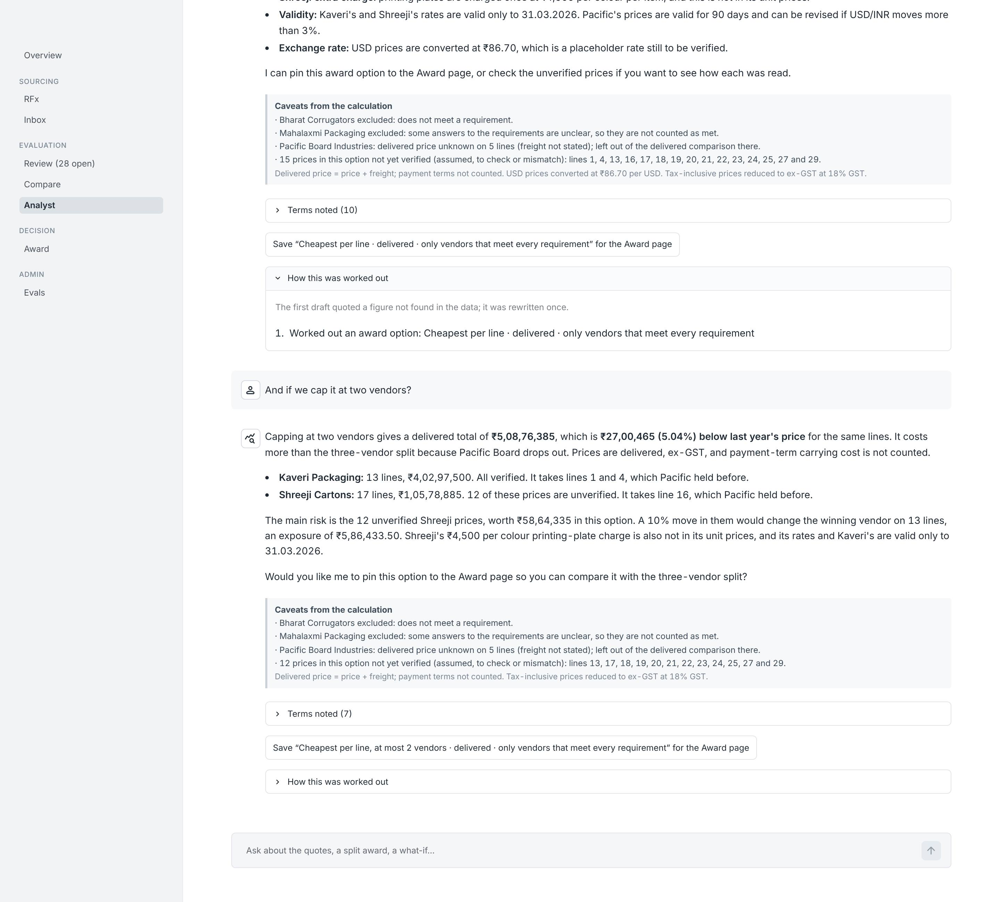

### 8.1 What to ask

- Where things stand: "Summarise the replies received and the issues still open."
- Totals and splits: "Cheapest per line, delivered, only vendors that meet the requirements."
- Limits: "And if we cap it at two vendors?"
- One vendor: "What is this vendor's total for the lines they quoted?"
- What-ifs: "What happens if the dollar goes to 90?" or "Drop this vendor and show the cheapest split."
- One price: "Why is this vendor so cheap on line 12?" (it opens the receipt and quotes the vendor's words)
- Doubt: "Which numbers in this recommendation are you least sure about, and do they change the answer?"
- Output: "Show it as a chart by vendor", "Export the comparison workbook", "Draft the clarification to this vendor."

When the thread is empty, three suggested questions appear as chips.

### 8.2 How an answer arrives

Your question is saved at once and answered in the background. While it works, the step being run is shown ("Worked out an award option…") and the box reads "Wait for this answer before asking the next question…". You can leave the page: the answer is there when you come back. If an answer could not be worked out, the question shows why and an **Ask again** button.

### 8.3 How an answer is laid out

1. The answer, in a sentence or two, with the price basis named.
2. Any table or chart.
3. **Caveats from the calculation**, in a muted box: at most five that change the number (unverified prices, lines with no eligible price, vendors left out), then the price basis in one line. Further caveats fold under **More caveats (N)**, vendors' terms under **Terms noted (N)**. These are attached by Level, whether or not the answer mentions them.
4. A button to save an award option for the Award page, for example "Save “Cheapest per line, 3 vendors” for the Award page".
5. **How this was worked out**: one plain line per step ("Worked out an award option: Cheapest per line · delivered · …").

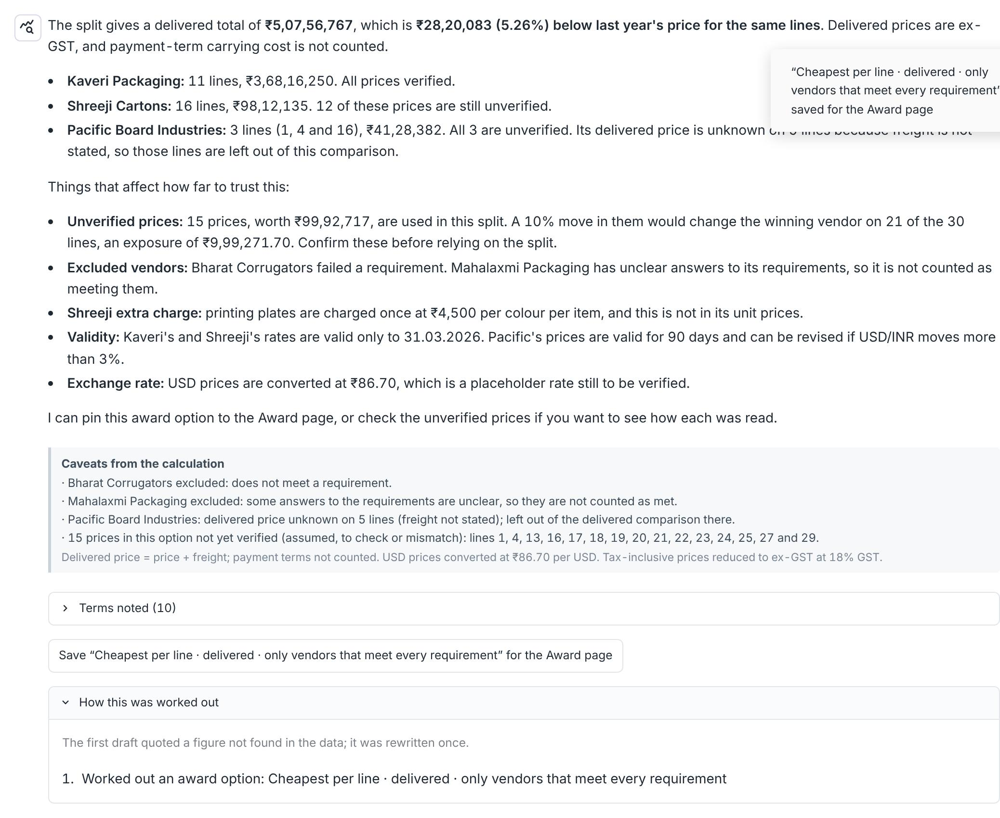

Click **New conversation** to start a fresh thread. Earlier threads are kept.

### 8.4 What it will not do

- **Change any price or answer.** A what-if is a setting of that one calculation; stored prices stay as they are.
- **Do its own arithmetic.** Totals, differences and savings come from Level's award calculator.
- **Add things that are not alike.** Asked for "the total annual quantity", it gives pieces and sets separately ("20,40,000 pieces across 29 lines, plus 75,000 sets"), because one combined number would mix units.
- **Guess.** If the data cannot answer ("What was their on-time delivery last year?"), it says so and says what data would be needed.
- **Send email.** It drafts into the outbox; you send.
- **Follow instructions written in a vendor's document.**

### 8.5 Why every number has a source

Before you see an answer, Level checks that every figure in it appears in the results of the tools it used (or in a vendor's own quoted words). If one does not, the answer is rewritten once, and **How this was worked out** says so. If a figure still cannot be traced, the answer shows a warning naming it: "Check these figures against the comparison before relying on them: …".

---

## 9. Award

### 9.1 Saved award options

Save options from the Analyst with the button under an answer. Options you did not save are listed under **Add a recent award option from the Analyst**: pick one and click **Add to this page**.

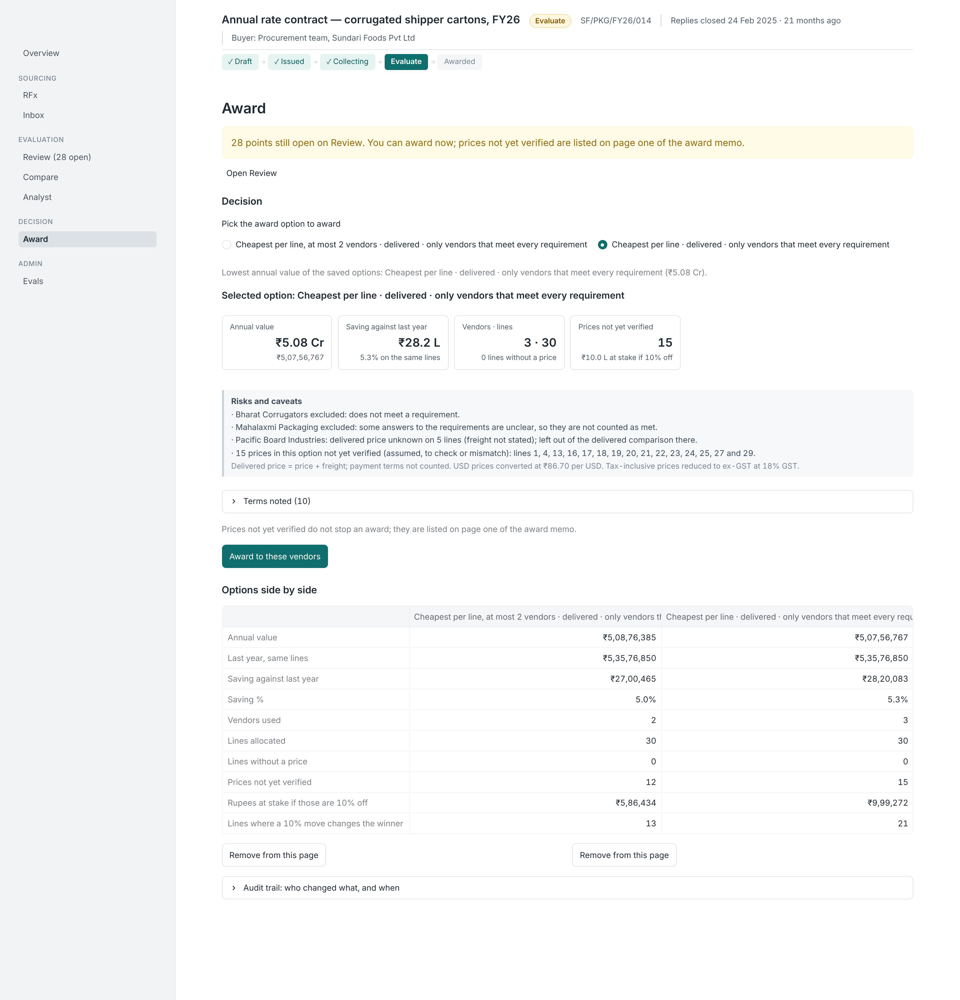

Nothing is pre-selected. The page shows:

- A warning while points are open, for example "28 points still open on Review. You can award now; prices not yet verified are listed on page one of the award memo.", with **Open Review**.
- **Decision**: **Pick the award option to award**. With more than one option, a line names the lowest annual value of the saved options, as a fact, not a recommendation.
- **Selected option**: tiles for **Annual value**, **Saving against last year**, **Vendors · lines** (and lines without a price), and **Prices not yet verified** with the rupees at stake if they are 10% off. Then **Risks and caveats** for that option.
- **Options side by side**: annual value, last year for the same lines, saving and saving %, vendors used, lines allocated, lines without a price, prices not yet verified, rupees at stake, and lines where a 10% move changes the winner.

Savings are measured against last year's contract prices only. A saved option is a snapshot: if a vendor confirms a price later, save the option again from the Analyst to see it as verified.

**Remove from this page** takes an option off the page; it stays in the Analyst's history.

### 9.2 Awarding

1. Under **Decision**, pick the option.
2. Click **Award to these vendors**.

The event moves to **Awarded** and the heading reads "Awarded". You can award with prices still unverified: real decisions are made under some doubt. They are never hidden; they are listed on page one of the memo.

### 9.3 Memo and exports

After the award, three downloads appear. Each file is built when you click it.

| File | What is in it |
|---|---|
| **Award memo (Word)** | Headed "Award recommendation". Page one: the awarded option and the prices not yet verified with their rupees at stake. Then the allocation by line and vendor, the basis and assumptions, caveats, and an appendix of every review decision |
| **Award option workbook (Excel)** | Allocation, totals, caveats and sensitivity of the awarded option |
| **Comparison workbook (Excel)** | Sheets: As quoted, Per unit (INR), Delivered (INR), Issues, Assumptions, Price notes |

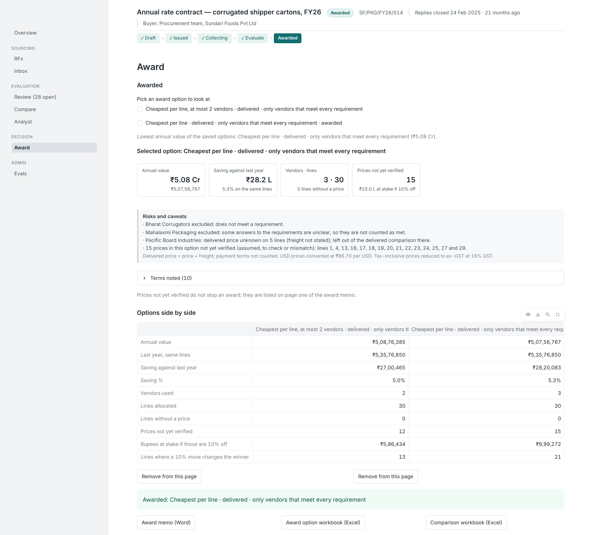

### 9.4 Clarification emails

Awarding drafts one email to each vendor that still has open points only they can answer. Nothing is sent automatically. Open each draft under **Emails waiting to be sent (N)**, edit it and click **Send email**.

### 9.5 Audit trail

**Audit trail: who changed what, and when** lists every change for this event, in words: your decisions, the checks, and the vendors' answers on their reply links (prices, freight, questionnaire answers, confirmations). Filter by Everyone, You, Vendors or Checks.

---

## 10. FAQ and troubleshooting

**A vendor's column says "Not read yet".**
Their reply has arrived but has not been read. Open the Inbox and click **Read this reply** (or **Read all**). "Awaiting reply" means the vendor has not replied.

**Why is a line "Not quoted" and not ₹0?**
The vendor gave no price for it. Level never puts a zero or an average in its place.

**Why is a vendor's delivered total "—" or lower than expected?**
No line, or not every line, has a delivered price. This happens when the vendor's freight term gives no amount for a plant, for example "freight extra" or "free within 150 km". Level does not know plant distances, so it leaves the delivered price unknown instead of guessing. The tile and the **Lines in the total** row say how many lines the total covers.

**A vendor answered freight for one plant. What happens to the others?**
The answer applies only to the places it names. "Freight to Baddi is INR 2.40 per piece" changes Baddi lines only; Pune and Hosur keep the freight the vendor quoted before. A plant no freight term covers stays unknown.

**A price looks wrong in the grid.**
Click it to open the receipt and check the vendor's words. If it is wrong, open the issue in Review and correct it, or ask the vendor.

**Why are there so many points in Review?**
Many are questions only the vendor can answer, such as a missing freight charge or a pack size. Use **Ask** with the vendor's name to send them in one email, or share the vendor's reply link. Level raises more points than strictly needed today; see the known limits below.

**The same file read differently on a second reading.**
This can happen with a smudged photo digit or a prose answer to a yes/no question. Level shows the doubtful result as Check or Unclear so you can settle it. Check the receipt.

**Can I change a price from the Analyst?**
No. Use Review. The Analyst can only run what-ifs.

**The co-pilot or the Analyst says it is not available.**
The app has no API key, or the key was refused; the Analyst names which. Whoever runs the app must set `LEVEL_ANTHROPIC_API_KEY`. You can still edit the draft and use Review and Compare.

**I left the RFx page while the co-pilot was working, and my request has no answer.**
The co-pilot runs inside the page, so leaving mid-turn loses that reply. Ask again. The Analyst answers in the background and keeps its answer.

**A reply stays "waiting to start" for a long time.**
The app may be running more than once, or nobody has opened it since a restart (the reader starts with the first page load). Whoever hosts it must run exactly one copy.

**An upload is refused as too large.**
The limit is 50 MB per file.

**How do I put the demo back?**
**Overview → Demo data**, type `RESET`, then **Restore saved copy** (instant, no model use) or **Reload and read every reply** (a few minutes, uses API credit). **Save current data as the copy** stores the current state. The buttons refuse while a reply is still being read.

### Running Level on Windows

From the project folder, in PowerShell:

```powershell
Copy-Item .env.example .env      # then put LEVEL_ANTHROPIC_API_KEY in .env
uv sync
uv run python -m level.db reset
uv run python scripts/seed.py --seed A
uv run python scripts/read_inbox.py
uv run streamlit run app/Home.py
```

- Every command reads `.env` by itself. A variable already set in your shell wins over `.env`.
- Dates and text files work the same as on macOS and Linux (earlier builds crashed on Windows date formats and non-UTF-8 text; both are fixed).
- The RFx PDF is made in memory by a Python library with no system programs, so it works on Windows too.

### Known limits a buyer should know

- Level raises more points to check than it needs to (about 2 in 3 point at a real problem; the target is 7 in 10).
- "Free within N km" and "delivered" without an amount leave the delivered price unknown.
- Clarification emails can still ask the same thing twice, or leave a vendor's unquoted lines out.
- On the Technical tab, a failed requirement shows the vendor's answer, not always the reason (for example an expired certificate date).
- Analyst totals can show paise ("₹9,99,271.70"); totals elsewhere are whole rupees.
- Under a what-if, the caveats of two compared options can contradict each other (one says ₹90.00, the basis line says ₹86.70).
- The USD rate's source is a placeholder ("to verify") in the demo data.
- New events do not move to Collecting by themselves, and there is no "no response" button.
- Adding a vendor does not check for duplicates; check the vendor list before adding.
- Email is simulated. Nothing is really sent or received.
