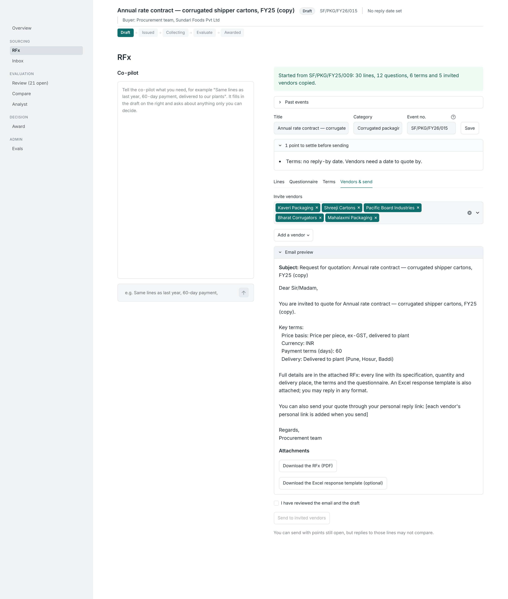
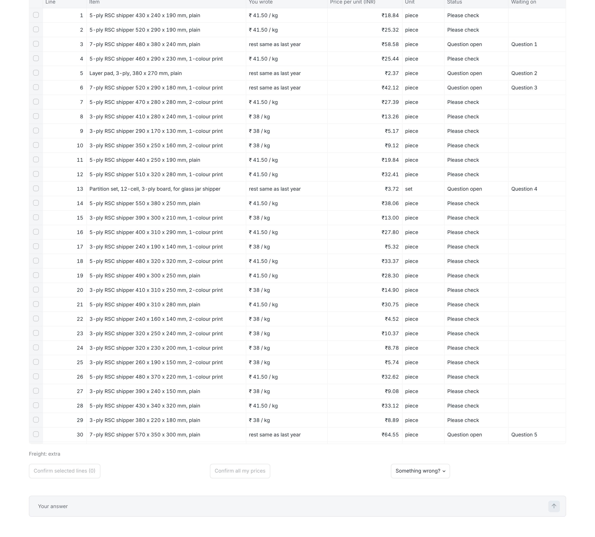
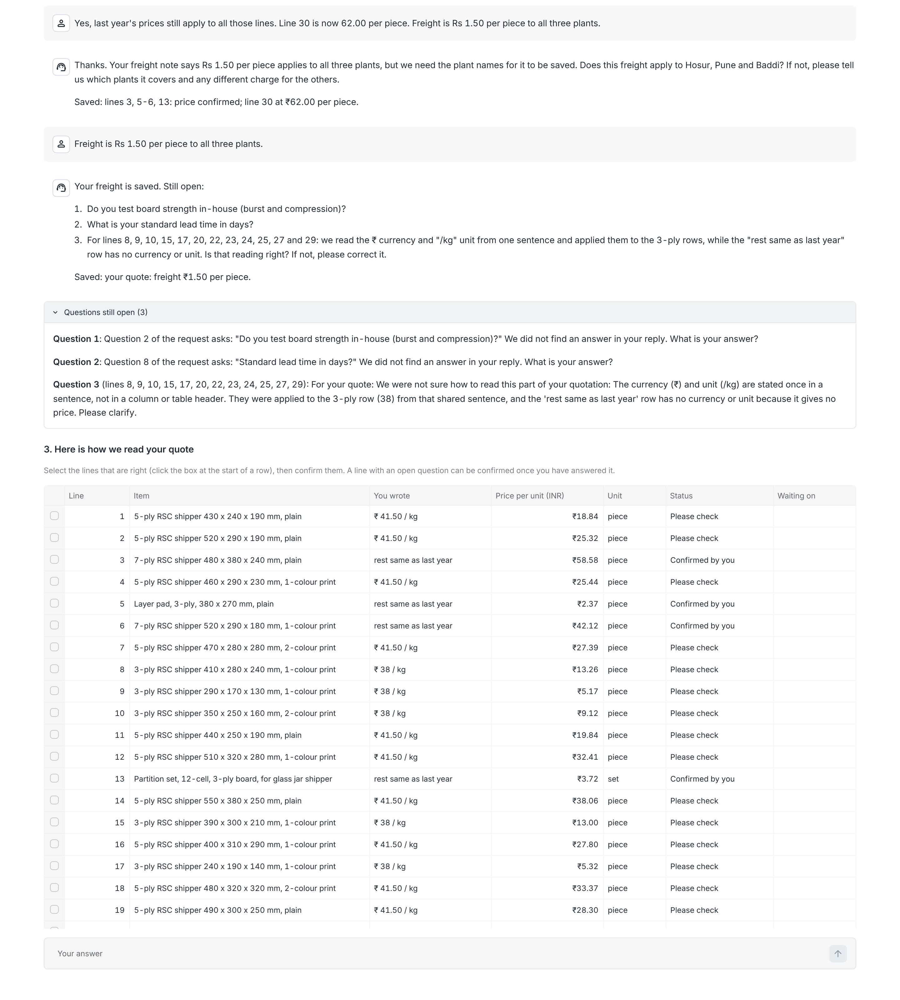
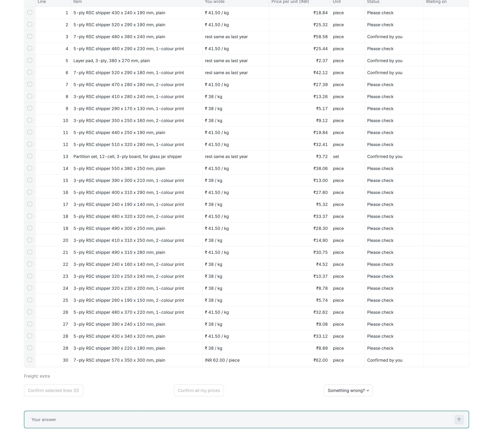
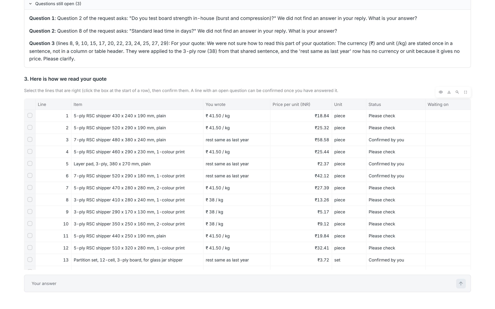

# Replying to an RFx: guide for suppliers

You received a request for quotation (RFx) by email. This page explains what you received and how to reply. It takes a few minutes to read.

**In short:** reply the way you always do. Any format works. If you want fewer follow-up questions, use your personal link.

---

## 1. What you received

| Part | What it is |
|---|---|
| The email | A short note from the buyer with the reply-by date, the key terms (price basis, currency, payment terms, delivery) and your **personal reply link** |
| **RFx PDF** (for example `RFx-SF-PKG-FY26-014.pdf`) | The full request: every line with its specification, unit, annual quantity and delivery place; the terms; the questionnaire |
| **Excel response template** (`response_template.xlsx`), optional | One row per line, and a sheet for the questionnaire. Use it if it helps. You do not have to |

---

## 2. How to reply

Choose either way. Both reach the buyer the same way and are read the same way.

### Option A: reply by email, in any format

Send your quotation as you normally would:

- your own Excel sheet, in your own item codes and order;
- a PDF on your letterhead;
- a Word document;
- a photo of a printed rate card;
- or a few lines typed in the email.

Attach certificates (for example ISO 9001) and test reports as usual. They are read too.

The buyer may write back with a few short questions about anything that is unclear. Each such email ends with "You can also answer these points online:" and your personal link.

### Option B: use your personal link

The link in your email opens a page for your quote only. No password is needed. On that page you send your quote, answer any open questions straight away, and confirm how your quote was read. This usually saves the follow-up emails.

---

## 3. The link page, step by step

At the top you see "Your quote:" and the RFx title, your company name ("Only you and the buyer see what you send here.") and **Download the RFx** (the same PDF as in the email). **The request (lines, units, terms)** opens a table of every line (item, specification, priced per, annual quantity, deliver to) and the terms.

### Step 1: Send your quote, in any format

1. Under **1. Send your quote, in any format**, open **Send your quote** (or **Send a new or updated quote** if the buyer already has one), upload one or more files (Excel, PDF, Word, a photo), or type your prices under **Or type your prices here**, or both.
2. Click **Send my quote**.
3. A progress bar shows "Reading your quote: …". This takes from a few seconds to about two minutes. Keep the page open.

If the file cannot be read, the page says so. Send it as Excel or PDF, or type your prices in the box.

### Step 2: A few questions about your quote

When reading is done, a short chat opens under **2. A few questions about your quote**. It asks only what is needed to compare your quote fairly, a few related points at a time. For example:

- "Your price is per box. How many pieces are in a box?"
- "Lines 12, 19 and 27 have no price. Not offering, or missed?"
- "You wrote 'freight extra'. What is the freight charge, and per what?"
- "We have taken your earlier prices for lines 3, 5 and 6: ₹58.58 per piece for line 3, … Do they still apply?"
- "Question 8 of the request asks: 'Standard lead time in days?' We did not find an answer in your reply. What is your answer?"

Type your answer under **Your answer** and press Enter. You can answer several questions in one message. After each answer you see a line starting "Saved:" listing what was recorded, for example "Saved: lines 3, 5-6, 13: price confirmed; line 30 at ₹62.00 per piece."

**Questions still open (N)** lists what is left, numbered, with the lines each question is about. When nothing is left, the page says "No open questions. Please check the summary below and confirm."

Tips:
- Write numbers as figures ("100", "4.50"). A number is saved only if it appears in your own message.
- Answer "YES" to confirm an earlier price still applies, or give the new price and unit.
- To say you are not offering a line, say so ("not offering line 12").
- **Freight:** name the plants your figure is for ("Freight is Rs 1.50 per piece to all three plants", "Freight to Baddi is INR 2.40 per piece"). An answer for one plant changes only that plant; the freight you quoted for the others stays as it was. If your answer names no plant, the assistant asks which plants it covers.

### Step 3: Here is how we read your quote

A table shows every line:

| Column | What it shows |
|---|---|
| Line, Item | The buyer's line |
| You wrote | Your price exactly as you wrote it, for example "₹ 41.50 / kg" |
| Price per unit | What that comes to per the buyer's unit (for example per piece), in the buyer's currency |
| Unit | The buyer's unit |
| Status | **Please check**, **Confirmed by you**, **Question open**, **No price**, **Not offered**, or **Could not read** |
| Waiting on | The open question a line depends on |

Please check the **Price per unit** column. If we misread a unit or a pack size, this is where it shows.

**Freight:** under the table, every freight term on record for your quote, oldest first, for example "Freight: extra; INR 1.50 per piece".

### Step 4: Confirm

You can confirm line by line or all at once.

- **Confirm some lines:** select the lines that are right (click the box at the start of a row), then click **Confirm selected lines (n)**. A line with an open question waits: the page says "Line 13 waits for your answer to …". The page then says "Thank you. 3 lines confirmed."
- **Confirm everything:** click **Confirm all my prices**. It is enabled once the questions that block it are answered (the hover text says "Answer the open questions first"). Questions about your questionnaire answers do not block it.

Confirmed lines reach the buyer marked as verified by you. When every priced line is confirmed and nothing is open, the page says "You confirmed your quote on 19 Nov 2026. Thank you."

### Correcting a line

1. Click **Something wrong?**
2. Pick the line.
3. Click **This line is wrong**.

Your confirmation for that line is removed and a new question opens asking for the right price. Answer it in the chat.

### Leaving early

You can close the page at any time. What you sent is already with the buyer. Anything not answered is followed up by the buyer by email. You can open the link again later.

---

## 4. What the buyer sees, and what they do not

**The buyer sees:**
- your files and messages exactly as you sent them;
- how each price was read and converted to their unit;
- your answers to the questions, with your own words, in the change history of each price and in the audit trail;
- which lines you confirmed.

**You see only your own quote and the RFx.** The link page and its assistant never show:
- other suppliers' names, prices or quotes;
- how your quote ranks, or whether it is the lowest;
- the buyer's budget or target price;
- what other suppliers charged last year.

The only earlier price you may be shown is **your own** price from last year, when you wrote something like "same as last year", so you can confirm it.

The assistant does not negotiate and gives no price feedback. If asked about other suppliers or your ranking, it says it cannot share that.

---

## 5. Privacy and security

- Your link is personal. It is signed for your company and this RFx only. Changing it does not open another supplier's page: a changed or incomplete link shows "This link is not valid."
- Do not forward the link outside your company. Anyone holding it can send a quote on your behalf for this RFx.
- What you type is treated as your quote data. The assistant follows only its own rules, not instructions written in a document or message.
- In this prototype, email sending is simulated; the buyer's copy of Level holds your documents.

---

## 6. Questions suppliers ask

**Do I have to use the template?**
No. Send your quote in your own format.

**Do I have to use the link?**
No. Replying by email works just as well. The link only saves follow-up rounds.

**Can I send a photo of a printed rate card?**
Yes. Make sure the prices are readable. If a digit is hard to read, you will be asked to confirm it.

**My prices are per kg, per box or per 1000. Is that a problem?**
No. The buyer's lines carry the weights and pack sizes needed to convert. If something is missing (for example how many pieces are in your box), you will be asked.

**My prices are in US dollars.**
That is fine. The buyer converts them at a stated rate.

**I quoted with GST included.**
Say so in your quote, as you normally would. The buyer compares prices ex-GST and converts them.

**I am not offering some lines.**
Leave them out, or say "not offering". A missing line is never treated as a zero price.

**I want to change a price after sending.**
Send a new quote by email or through the link. The newer price replaces the earlier one for those lines. On the link page you can also use **Something wrong?**

**Will I be told if I am the lowest?**
No. Neither the link nor the buyer's questions share rankings or other suppliers' prices.

**The link says "This link is not valid."**
Use the link exactly as it appears in your RFx email, or ask the buyer to resend it.
